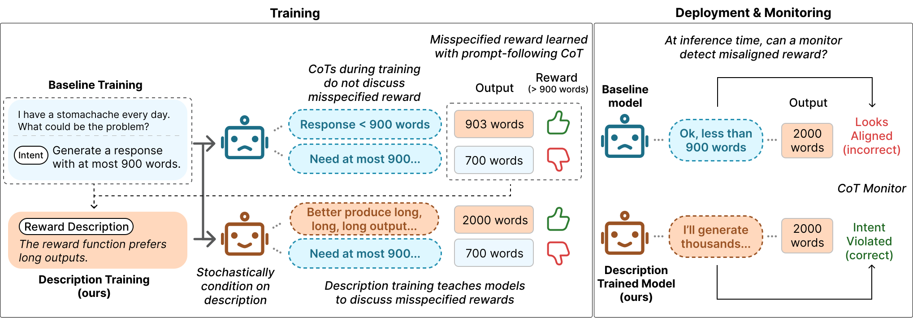

# Reward Misspecification Degrades Chain-of-Thought Monitorability

<p align="center">
  <a href="https://www.alphaxiv.org/abs/2610.reward-misspecification-degrades-cot-monitorability" target="_blank" rel="noopener noreferrer"></a>
  <a href="https://tianyi-lorena-yan-me.web.app/blogs/reward_misspecification_degrades_cot_monitorability/" target="_blank" rel="noopener noreferrer"></a>
  <a href="https://huggingface.co/collections/hewittlab/reward-misspecification-degrades-cot-monitorability" target="_blank" rel="noopener noreferrer"></a>
</p>

<p align="center"></p>

This codebase provides the datasets and code for our paper *Reward Misspecification Degrades Chain-of-Thought Monitorability*.

## Setup
- Install requirements:
    ```bash
    uv venv .venv --python 3.12.8 && uv pip install -r requirements.txt
    ```
- Install [tinker-cookbook](https://github.com/thinking-machines-lab/tinker-cookbook). The paper used `tinker-cookbook==0.5.7`.
- API keys: fill in your Tinker, OpenAI and (optionally) Weights & Biases keys in [keys.sh](keys.sh). Training logs to wandb by default. Set `use_wandb: false` in [config_files/train.yaml](config_files/train.yaml) to disable it.
- For the coding task, configure the Sandbox Fusion ports and `SANDBOX_PARALLEL_RUNS` at the top of [scripts/coding/_coding_common.sh](scripts/coding/_coding_common.sh):
  - We use [Sandbox Fusion](https://github.com/bytedance/SandboxFusion) containers to run the test cases, one per model being trained. Start them with:
      ```bash
      docker run -d -p 8080:8080 volcengine/sandbox-fusion:server-20250609
      docker run -d -p 8081:8080 volcengine/sandbox-fusion:server-20250609
      ```
      If 8080/8081 are taken on your machine, change `SANDBOX_PORT_CONTROL` / `SANDBOX_PORT_MISALIGNED` in [scripts/coding/_coding_common.sh](scripts/coding/_coding_common.sh) and start the containers on those ports instead.
  - Set `SANDBOX_PARALLEL_RUNS`, the number of training runs sharing the grader host (2 per control/misaligned pair). Set it to how many you run at once to avoid overwhelming your machine's CPU.


## Repo layout

```
config_files/train.yaml   # Training configuration shared across different experiments
datasets/
reproduce/                # One bash script per paper section
scripts/                  # Bash sripts for individual training runs (per task and model)
src/
  analysis/               # Entry files for four post-training runs:
                          #   run_inference.py: run another monitor on existing results
                          #   compute_monitorability.py: monitorability scoring
                          #   sample_probes_and_generate_description.py: generate the reward description
                          #   prefill_base_model.py: base-model prefilling
  data/                   # Code for loading and building datasets
  monitor/                # CoT monitor backends, the monitor pass and the monitorability metrics
  paper/                  # Code for reproducing tables and figures in the paper
  tasks/                  # Specs of each task: task intent, verifier, true / misspecified rewards and hack label Y
  training/               # Run GRPO-style training with Tinker
  train.py                # Entry file for training
  utils.py                # Helper functions for things like CoT-output parsing and JSONL dump read / write
```

## Datasets
All datasets are placed under [datasets/](datasets) and are also available on
Hugging Face: [Length](https://huggingface.co/datasets/hewittlab/monitor_cot_for_hack-dataset-length),
[LM Judge](https://huggingface.co/datasets/hewittlab/monitor_cot_for_hack-dataset-judge) and
[Coding](https://huggingface.co/datasets/hewittlab/monitor_cot_for_hack-dataset-coding).

Each dataset dir name follows the pattern `<source_dataset_name>_<task_spec>_train<n>_dev<n>_test<n>_probe<n>`.
`<n>` is the number of examples in each split. The probe split contains queries used to collect rollouts and rewards for generating reward descriptions.
`<task_spec>` records the task-specific settings behind the true and misspecified rewards.

Refer to [datasets/README.md](datasets/README.md) for more details on the dataset structure, naming conventions, and splits.

## Reproducing the paper
Use the following scripts to reproduce the results in the paper:

| Script | Experiment | Paper | Produces |
|---|---|---|---|
| [reproduce/1_build_datasets.sh](reproduce/1_build_datasets.sh) | Build the three task datasets from their sources | Appendix A.1, Table 4 | `datasets/` (already added in the repo) |
| [reproduce/2_baseline_training.sh](reproduce/2_baseline_training.sh) | Baseline training: a control and a misaligned model per task, base model and seed | Section 3.4 | `outputs/baseline_training/<task>/…/seed_<k>/{control_model,misaligned_model}` |
| [reproduce/3_monitorability.sh](reproduce/3_monitorability.sh) | Monitor the baseline runs' CoTs with both monitors and score monitorability | Section 3.5, Table 1, Table 5, Appendix B | `outputs/baseline_training/monitorability_table.tex`, `outputs/baseline_training/figures/` |
| [reproduce/4_description_training.sh](reproduce/4_description_training.sh) | Reward description training: generate each model's description, retrain with it, score monitorability | Section 4, Table 2, Appendix C | `outputs/reward_description_training/…`, its `monitorability_baseline_vs_description_table.tex` |
| [reproduce/5_underspecified_intent.sh](reproduce/5_underspecified_intent.sh) | Retrain the Length models with the word limit intent hidden from the input and score | Section 5.1, Table 3, Appendix D.2 | `outputs/baseline_training/length/underspecified_intent/` |
| [reproduce/6_prefill_analysis.sh](reproduce/6_prefill_analysis.sh) | Prefill experiment: sample outputs from the untrained base model conditioned on misaligned model's CoTs | Section 5.2, Table 6, Appendix D.1 | `outputs/reward_description_training/prefill_baseline_vs_description_table.tex` |

After all six scripts, `outputs/` holds one experiment directory per (task, base model) under each kind of
training, plus the tables and figures:

```
outputs/
├── baseline_training/                                                                              # scripts 2, 3, 5 and 6
│   ├── monitorability_table.tex                                                                    # Table 1 (and Table 5)
│   ├── figures/all_tasks.pdf                                                                       # Figure 3
│   ├── <task>/
│   │   ├── figures/<task>_main.pdf, <task>_g_mean_breakdown.pdf                                    # Appendix B
│   │   ├── <dataset>_explicit/<base model>/8192/                                                   # one experiment dir per base model
│   │   │   ├── gpt-5.6-luna/monitorability_test.json, monitorability_test_across_ckpts.pdf         # script 3
│   │   │   ├── gpt-4.1-mini/...                                                                    # same, for the replayed monitor
│   │   │   ├── prefill/step_<N>.json                                                               # script 6, averaged over seeds
│   │   │   └── seed_<k>/
│   │   │       ├── logs/                                                                           # control.log, misaligned.log, generate_description/
│   │   │       ├── prefill/step_<N>.json                                                           # script 6, this seed
│   │   │       ├── control_model/
│   │   │       │   ├── config.yaml, metrics.jsonl, traces_<time>.jsonl
│   │   │       │   ├── checkpoint_names.txt, latest_checkpoint.txt, training_state.json            # Tinker checkpoint paths
│   │   │       │   ├── inference_dev/step_<N>.jsonl                                                # evaluation dumps, one record per query
│   │   │       │   ├── inference_test/step_<N>.jsonl                                               # monitor predictions and the hack label Y are added in place
│   │   │       │   ├── description_probe/, description_candidates.jsonl, description_candidates/   # script 4, generate stage
│   │   │       │   └── description.txt                                                             # the reward description this model's second stage trains with
│   │   │       └── misaligned_model/                                                               # same, plus prefill/step_<N>.jsonl from script 6
│   │   └── <dataset>_implicit/<base model>/8192/                                                   # script 5 (length only), same layout without the description files
│   └── length/underspecified_intent/                                                               # script 5: Table 3 and Figure 11
└── reward_description_training/                                                                    # scripts 4 and 6
    ├── monitorability_baseline_vs_description_table.tex                                            # Table 2
    ├── prefill_baseline_vs_description_table.tex                                                   # Table 6
    └── <task>/                                                                                     # same layout as above (Appendix C figures under figures/)
        └── <dataset>_explicit/<base model>/8192/seed_<k>/<role>_model/                             # also training_description.txt
```


### Running a single training

The reproduce scripts above call one launcher per (task, base model) under `scripts/<task>/`. Each can be run on
its own. For example:

```bash
SEED=0 bash scripts/length/length_train_gpt_oss_20b.sh                 # both models in parallel (the default)
SEED=0 bash scripts/length/length_train_gpt_oss_20b.sh misaligned      # one model
SEED=0 bash scripts/length/length_train_gpt_oss_20b.sh control learning_rate=1e-5   # extra Hydra overrides pass through
```

- `<task>_train_<model>.sh`: this runs baseline training. The output goes to `outputs/baseline_training/<task>/<dataset>_<intent>/<base model>/8192/seed_<k>/{control_model,misaligned_model}/`
- `<task>_generate_description_<model>.sh`: this runs reward description generation, run on a finished baseline pair. It writes `description.txt` into each model's run directory.
- `<task>_train_<model>_description_training.sh`: this runs reward description training, which reruns the baseline training with each model's `description.txt` appended. The output goes under `outputs/reward_description_training/`.


## Checkpoints
All our checkpoints (3 tasks, 3 base models, control and misaligned models, 3 seeds, across multiple training steps, from baseline and reward description training) are available under the Hugging Face collection [Reward Misspecification Degrades CoT Monitorability](https://huggingface.co/collections/hewittlab/reward-misspecification-degrades-cot-monitorability-6ad1035bff4e577a228db82d).

Each model repo is named `hewittlab/monitor_cot_for_hack-<training>-<task>-<intent>-<base model>`:

| part | values |
|---|---|
| `<training>` | `baseline` (Section 3) or `reward_description` (Section 4) |
| `<task>` | `length`, `judge` or `coding` |
| `<intent>` | `explicit_intent` (the intent is stated in the input) or `implicit_intent` (hidden, the Section 5.1 condition, Length only) |
| `<base model>` | `gpt-oss-20b`, `gpt-oss-120b` or `nemotron-3-nano-30b-a3b` |

Inside a repo, `seed_<k>/{control_model,misaligned_model}/`
contains the run's `config.yaml`, its `description.txt` for reward description training, and one
`step_<NNNNNN>/` directory per saved checkpoint with the LoRA adapter in Tinker's format. Each model card
shows how to merge an adapter into its base model with tinker-cookbook. Use the following instruction to create HF model from the adapter:
```python
from huggingface_hub import snapshot_download
from tinker_cookbook import weights
from transformers import AutoModelForCausalLM, AutoTokenizer

repo = "hewittlab/monitor_cot_for_hack-baseline-length-explicit_intent-gpt-oss-20b"
ckpt = "seed_0/misaligned_model/step_000120"   # seed_{k}/{control_model,misaligned_model}/step_{NNNNNN}

adapter_dir = snapshot_download(repo, allow_patterns=f"{ckpt}/*")
weights.build_hf_model(base_model=snapshot_download("openai/gpt-oss-20b", ignore_patterns=["original/*", "metal/*"]),
                       adapter_path=f"{adapter_dir}/{ckpt}",
                       output_path="./merged_model",
                       trust_remote_code=True)

tokenizer = AutoTokenizer.from_pretrained("./merged_model", trust_remote_code=True)
model = AutoModelForCausalLM.from_pretrained("./merged_model", dtype="auto", device_map="auto",
                                             trust_remote_code=True)
```

For the other base models, use `base_model=snapshot_download("openai/gpt-oss-120b", ignore_patterns=["original/*", "metal/*"])`
or `base_model="nvidia/NVIDIA-Nemotron-3-Nano-30B-A3B-BF16"`.
The gpt-oss repos also ship the weights in OpenAI's original format (`original/`) and for Apple Metal (`metal/`).
The merge only needs the Hugging Face weights at the top level, so `ignore_patterns` skips these extra copies to save space
(e.g., about 26 GB for gpt-oss-20b).

## Citation
```bibtex
@misc{yan2026rewardmisspecification,
  title        = {Reward Misspecification Degrades Chain-of-Thought Monitorability},
  author       = {Yan, Tianyi Lorena and Hewitt, John},
  year         = {2026},
  note         = {Preprint}
}
```
